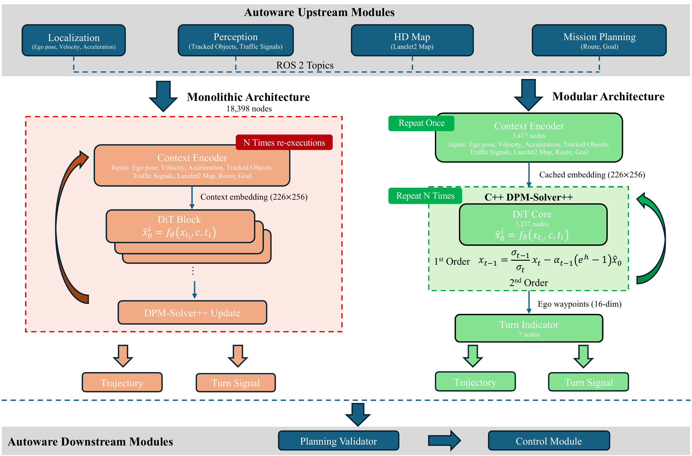
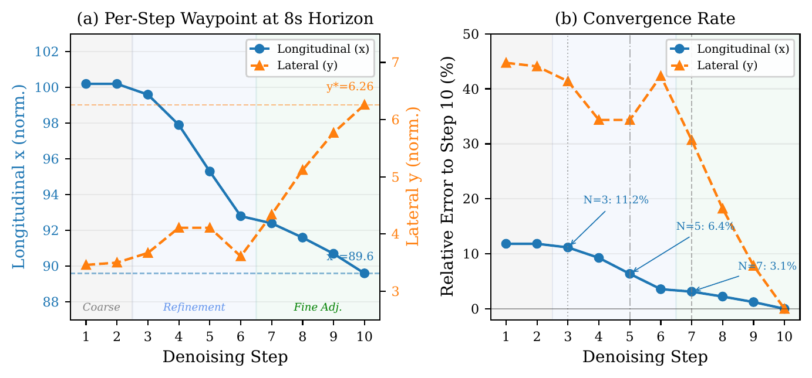
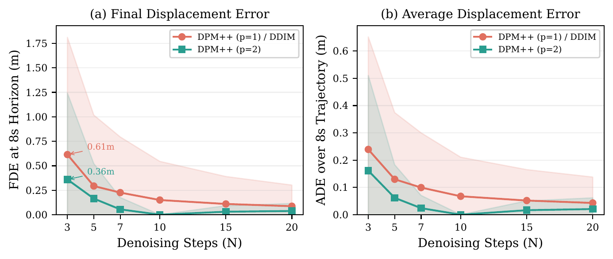
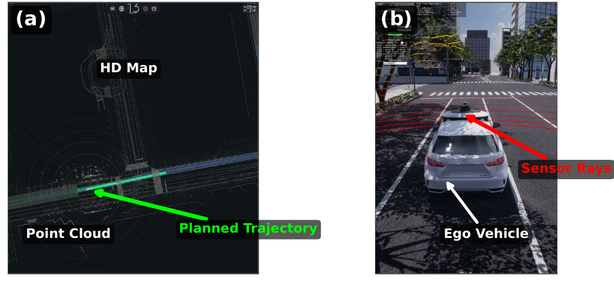

<h1 align="center">An Open-Source Modular Benchmark for Diffusion-Based Motion Planning in Closed-Loop Autonomous Driving</h1>

<p align="center">
Yun Li<sup>1</sup>, Simon Thompson<sup>2</sup>, Zifan Zeng<sup>3</sup>, Qunli Zhang<sup>3</sup>, Shiming Liu<sup>3</sup>,<br>
Peng Wang<sup>3</sup>, Yidu Zhang<sup>1</sup>, Ehsan Javanmardi<sup>1</sup>, Manabu Tsukada<sup>1</sup><br>
<sup>1</sup>The University of Tokyo &nbsp;&nbsp; <sup>2</sup>TIER IV, Inc. &nbsp;&nbsp; <sup>3</sup>Huawei
</p>

<p align="center">


</p>

<p align="center"></p>

> A deployed diffusion planner arrives as one compiled graph with the denoising loop baked inside. You cannot change the number of steps, swap the solver, or see what the model predicted along the way. We cut the graph apart and move the loop into C++, so all three become possible inside a production stack.

## Abstract

Diffusion-based motion planners have achieved state-of-the-art results on benchmarks such as nuPlan, yet their evaluation within closed-loop production autonomous driving stacks remains largely unexplored. Existing evaluations abstract away ROS 2 communication latency and real-time scheduling constraints, while monolithic ONNX deployment freezes all solver parameters at export time. We present an open-source modular benchmark that addresses both gaps: using ONNX GraphSurgeon, we decompose a monolithic 18,398-node diffusion planner into three independently executable modules and reimplement the DPM-Solver++ denoising loop in native C++. Integrated as a ROS 2 node within Autoware, the open-source AD stack deployed on real vehicles worldwide, the system enables runtime-configurable solver parameters without model recompilation and per-step observability of the denoising process, breaking the black box of monolithic deployment. Unlike evaluations in standalone simulators such as CARLA, our benchmark operates within a production-grade stack and is validated through AWSIM closed-loop simulation. Through systematic comparison of DPM-Solver++ (first- and second-order) and DDIM across six step-count configurations (N ∈ {3, 5, 7, 10, 15, 20}), we show that encoder caching yields a 3.2× latency reduction, and that second-order solving reduces FDE by 41% at N = 3 compared to first-order.

## Key results

| | |
|---|---:|
| Largest difference from the original graph, after splitting a single module | < 10<sup>-5</sup> |
| …after ten sequential solver steps, in physical space | < 2 mm |
| FDE at N = 3, second-order solver vs. first-order (0.61 m → 0.36 m) | **−41 %** |
| A schedule designed for 3 steps (0.36 m) vs. truncating the 10-step schedule after 3 (2.53 m) | **7×** |
| Cost of one additional denoising step, CPU | 2.3 ms |
| Closed-loop in AWSIM: planning cycles on the Nishi-Shinjuku urban route, no collision | 600+ |

DPM-Solver++ at first order produced numerically identical outputs to DDIM in every configuration, an empirical confirmation of the known theoretical equivalence for data-prediction models.

## Method

The deployed planner is a single ONNX graph of 18,398 operations: the context encoder, eleven copies of the DiT block and the solver arithmetic, all fused together. Step count, solver order and noise schedule are fixed when that graph is exported.

We cut it at the context embedding with [ONNX GraphSurgeon](https://github.com/NVIDIA/TensorRT/tree/main/tools/onnx-graphsurgeon) and drive the loop from outside:

| Module | Operations | Size | Runs |
|---|---:|---:|---|
| `context_encoder_v2.onnx` — map, agents, traffic lights → context embedding | 3,417 | 18 MB | once per planning cycle, cached |
| `dit_core.onnx` — one denoising step | 1,237 | 28 MB | N times, N set at runtime |
| `turn_indicator_calculator.onnx` — turn-signal head | 7 | 5.6 KB | once, after the trajectory |

(The ROS 2 node reads the turn-indicator layer from a small JSON of weights rather than this ONNX; `graphsurgeon_split.py` writes both.)

The DPM-Solver++ loop is reimplemented in native C++ with the step count (N ∈ [1, 50]), the solver order (p ∈ {1, 2}) and the VP noise schedule (β₀, β₁) exposed as ROS 2 parameters. Each step count gets its own timestep schedule, spaced uniformly in log-SNR. Nothing is recompiled and the network weights are untouched — the loop is now ordinary C++, so a different update rule or scheduler is a code change in one file rather than a model re-export.

## Results

### Watching the planner denoise

<p align="center"></p>

Because the C++ solver calls the DiT core explicitly, every intermediate prediction can be logged — information the fused graph does not expose. On a real AWSIM frame the denoising falls into three phases: the prediction barely moves in steps 1–2, almost all of the change happens in steps 3–6, and steps 7–10 only shrink the corrections. The longitudinal error is down to 6.4 % by step 5 and below 3.1 % by step 7. The lateral axis converges more slowly and non-monotonically.

### Solver comparison

<p align="center"></p>

Fifty evenly sampled AWSIM frames replayed through the DiT core with three solvers at six step counts. Second-order solving reduces FDE by 41 % at N = 3 and reaches first-order accuracy at roughly half the steps. Re-designing the timestep schedule for a smaller N matters as much as the solver itself: 0.36 m against 2.53 m for naive early stopping.

### Closed loop in Autoware and AWSIM

<p align="center"></p>

The node is a drop-in replacement for the monolithic planner inside Autoware. Over 600+ planning cycles on an urban route in the Nishi-Shinjuku map the vehicle completes the route without collisions, holding a steady ~10 Hz.

## What this repository contains

| Folder | What it holds |
|---|---|
| `planner/autoware_diffusion_planner_onnx_split_cpp/` | **The reference implementation**: split ONNX, native C++ DPM-Solver++, encoder caching, per-step logging |
| `planner/autoware_diffusion_planner/` | The upstream TIER IV package consuming the monolithic ONNX — the baseline, bundled for comparison |
| `scripts/onnx_split/` | `graphsurgeon_split.py` cuts the monolithic graph; `analyze_onnx_split.py` finds the cut point |
| `weights/v2.0/` | The split ONNX weights used in the paper (46 MB) with SHA-256 sums |
| `benchmarks/` | Latency and solver benchmarks, the cached `.npz` from our runs, and the script that draws the paper figures |
| `patches/` | Diff against upstream `autowarefoundation/autoware_universe` |
| `figures/`, `assets/` | The paper figures (PDF) and the images on this page |

## Quick start

### Reproduce the paper figures — no Autoware needed

```bash
cd benchmarks
pip install -r requirements.txt
python gen_figures.py              # reads the cached data/*.npz from our runs
```

Figures are written to `benchmarks/figures/`. The denoising, caching, solver-comparison and Pareto figures come straight from the cached data. The step-sensitivity figure additionally needs the per-step `summary.log` of a closed-loop run, which is not redistributed here — point `$DIFFUSION_PLANNER_SUMMARY_LOG` at your own run, or skip it.

### Build the ROS 2 node

Copy both packages under `planner/` into your Autoware workspace `src/` and build:

```bash
cd ~/autoware_ws
colcon build --packages-select \
    autoware_diffusion_planner_onnx_split_cpp \
    autoware_diffusion_planner
source install/setup.bash
```

### Run it

```bash
ros2 launch autoware_diffusion_planner_onnx_split_cpp diffusion_planner_onnx_split.launch.xml
```

Step count, solver order and noise schedule are ROS 2 parameters
(`planner/autoware_diffusion_planner_onnx_split_cpp/config/diffusion_planner.param.yaml`) — change them and relaunch, no rebuild and no re-export:

```yaml
num_inference_steps: 10     # 1 … 50
solver_order:         2     # 1 = first-order, 2 = second-order DPM-Solver++
beta_0:               0.1   # VP noise schedule
beta_1:              20.0
```

> **Set the model paths first.** The shipped config points at a local development checkpoint. Point `encoder_model_path` and `dit_model_path` at [`weights/v2.0/`](weights/v2.0/), and `turn_indicator_weights_path` at a `turn_indicator_weights.json` produced by `graphsurgeon_split.py --weights-only` from the base checkpoint (that JSON is not redistributed here).

DDIM is compared against DPM-Solver++ in the offline benchmark (`benchmarks/offline_solver_benchmark.py`); the ROS 2 node itself implements the first- and second-order DPM-Solver++ updates.

<details>
<summary><b>Splitting your own model</b></summary>

<br>

The weights under `weights/v2.0/` are already split, so the benchmarks run without this step. To split a different checkpoint:

```bash
pip install onnx onnx-graphsurgeon
python scripts/onnx_split/graphsurgeon_split.py \
    --onnx     ~/autoware_data/diffusion_planner/v2.0/diffusion_planner.onnx \
    --backbone ~/autoware_data/diffusion_planner/v2.0/diffusion_backbone.onnx \
    --output-dir ./split_out
# writes context_encoder_<version>.onnx, dit_core.onnx
# and turn_indicator_weights.json
```

The version is detected from the graph; cut points for v2.0 and v3.0 are in `get_cut_points()`. `analyze_onnx_split.py` scores candidate tensors if you need a new one, and `--encoder-only` / `--dit-only` / `--weights-only` produce one artefact at a time. Verify the bundled split with:

```bash
cd weights/v2.0 && sha256sum -c SHA256SUMS
```

</details>

<details>
<summary><b>Regenerating the benchmark data from your own runs</b></summary>

<br>

`benchmarks/data/*.npz` holds the results behind the paper figures. To recompute them you need the ONNX models and a directory of captured input tensors:

```bash
export DIFFUSION_PLANNER_MODEL_DIR=~/autoware_data/diffusion_planner/v2.0
export DIFFUSION_PLANNER_LOG_DIR=/path/to/captured/awsim_frames
export DIFFUSION_PLANNER_SUMMARY_LOG=$DIFFUSION_PLANNER_LOG_DIR/summary.log

python benchmarks/latency_benchmark.py          # per-component latency, 100 runs
python benchmarks/offline_solver_benchmark.py   # FDE/ADE for each solver × N
python benchmarks/gen_figures.py
```

`DIFFUSION_PLANNER_LOG_DIR` holds the per-frame `.bin` tensors the planner writes in debug mode; `summary.log` in the same directory carries the per-step predictions that `analyze_steps.py` and the step-sensitivity figure read.

</details>

<details>
<summary><b>Experimental setup used in the paper</b></summary>

<br>

Intel Core i9-12900KS, 32 GB RAM, NVIDIA GeForce RTX 3090 Ti, in a Docker container with Ubuntu 22.04, ROS 2 Humble and Autoware. The modular planner runs on ONNX Runtime 1.23 with the **CPU** execution provider; the monolithic baseline runs on TensorRT. Both are benchmarked on the same machine so that the comparison isolates the architecture rather than the hardware. Closed-loop evaluation uses AWSIM on an urban route in the Nishi-Shinjuku map. Unless stated otherwise: N = 10, second order, VP schedule with β₀ = 0.1, β₁ = 20.0, temperature 0 (deterministic sampling, zero initial noise) — the settings of the original deployment.

</details>

## Base planner

The planner is the diffusion planner of Autoware ([`autoware_diffusion_planner`](https://github.com/autowarefoundation/autoware_universe/tree/main/planning/autoware_diffusion_planner) in Autoware Universe), following Zheng et al., [*Diffusion-Based Planning for Autonomous Driving with Flexible Guidance*](https://arxiv.org/abs/2501.15564), ICLR 2025. The base model is downloaded by Autoware's `setup-dev-env.sh`; the split weights here are derived from its v2.0 checkpoint.

## What is not included

- The base monolithic checkpoint (`diffusion_planner.onnx`) and its TensorRT engine.
- The lanelet2 map and AWSIM scenario of the Nishi-Shinjuku route.
- The raw per-frame tensor dumps; `benchmarks/data/*.npz` holds the derived results.

## Citation

```bibtex
@inproceedings{li2026modular,
  title     = {An Open-Source Modular Benchmark for Diffusion-Based Motion Planning in Closed-Loop Autonomous Driving},
  author    = {Li, Yun and Thompson, Simon and Zeng, Zifan and Zhang, Qunli and Liu, Shiming and Wang, Peng and Zhang, Yidu and Javanmardi, Ehsan and Tsukada, Manabu},
  booktitle = {2026 IEEE International Conference on Intelligent Transportation Systems (ITSC)},
  year      = {2026},
  publisher = {IEEE}
}
```

See [`CITATION.bib`](CITATION.bib).

## Acknowledgements

- Original diffusion planner architecture and weights: [Zheng et al.](https://arxiv.org/abs/2501.15564), ICLR 2025
- Upstream Autoware integration: TIER IV, Inc.
- Closed-loop simulator: [AWSIM](https://github.com/tier4/AWSIM)

## License

Apache License 2.0 — see [`LICENSE`](LICENSE) and [`NOTICE`](NOTICE).

`planner/autoware_diffusion_planner` is a derivative of the upstream [Autoware Universe diffusion planner](https://github.com/autowarefoundation/autoware_universe/tree/main/planning/autoware_diffusion_planner) (© TIER IV, Inc., Apache 2.0); our modifications are listed in [`patches/modular_planner_vs_upstream.patch`](patches/modular_planner_vs_upstream.patch).
